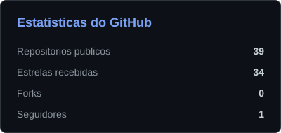
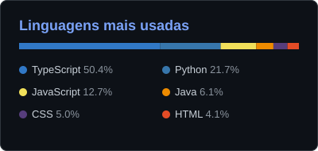



  

  <h3>Desenvolvedor Backend · Java 21 / Spring Boot 3 · Node.js / TypeScript · Python</h3>
  
Sistemas transacionais, arquiteturas orientadas a eventos, DevSecOps e agentes de IA com governança.

  

    
    &nbsp;
    
    &nbsp;
    
  

---

## 🎯 Sobre Mim

Estudante de Engenharia de Software (6º período), com experiência prática em **monitoramento de sistemas críticos, mitigação de incidentes e troubleshooting de processos na Sitran**. Construo **backends resilientes e microsserviços** com foco em integridade transacional (idempotência, locks pessimistas, partidas dobradas), processamento assíncrono (filas, streams, retentativas, DLQ) e segurança (JWT, rate limiting, auditoria SARIF).

Meus projetos de destaque seguem o mesmo padrão: **Clean Architecture, testes automatizados, Docker Compose e CI com GitHub Actions**.

---

## 🛠️ Stack

| Categoria | Tecnologias |
|---|---|
| **Linguagens** |      |
| **Backend** |         |
| **Mensageria & Cache** | -DC382D?style=flat-square&logo=redis&logoColor=white)  |
| **Banco de Dados & ORM** |        |
| **DevOps & Infra** |    -181717?style=flat-square&logo=github&logoColor=white) |
| **Testes & Qualidade** |       |
| **Segurança & Contratos** | JWT, Bcrypt, Zod, Helmet, Rate Limiting, OpenAPI / Swagger UI |
| **IA** |  Function Calling, Human-in-the-Loop, Hugging Face Spaces |
| **Arquitetura** | Clean Architecture, SOLID, Design Patterns (GoF), Microsserviços, Event-Driven, Saga, Circuit Breaker, API Gateway, Double-Entry Bookkeeping, Idempotência |

---

## 🚀 Projetos em Destaque

### 🏦 Sistemas Financeiros & Transacionais

| Projeto | Stack | Diferencial técnico |
|---|---|---|
| 🌐 [**enterprise-microservices-ecosystem**](https://github.com/ViktorGabriel/enterprise-microservices-ecosystem) | Docker Compose, Git Submodules, GitHub Actions | Meta-repositório que orquestra API financeira (Java) e motor de eventos (Node), com E2E integrado e auditoria DevSecOps (SARIF) |
| 🏦 [**microservico-enterprise**](https://github.com/ViktorGabriel/microservico-enterprise) | Java 21, Spring Boot 3, JPA, Flyway, PostgreSQL | Clean Architecture, JWT stateless, idempotência, bloqueio pessimista e testes de integração |
| 📒 [**ledger-core-banking**](https://github.com/ViktorGabriel/ledger-core-banking) | Java 21, Spring Boot 3, Docker | Ledger de partidas dobradas com bloqueio pessimista e chave de idempotência |
| 💸 [**financial-ledger-service**](https://github.com/ViktorGabriel/financial-ledger-service) | Fastify 5, Prisma 6, BullMQ, Redis, PostgreSQL, Vitest | Contabilidade imutável em `bigint`, Saga, filas assíncronas, `SELECT FOR UPDATE` e CI |
| 💰 [**dashboard-financeiro**](https://github.com/ViktorGabriel/dashboard-financeiro) | TypeScript, Prisma, JWT, Vitest | API REST de finanças pessoais com autenticação stateless e CI automatizado |

### 📨 Mensageria, Tempo Real & Alta Vazão

| Projeto | Stack | Diferencial técnico |
|---|---|---|
| 📨 [**event-driven-api**](https://github.com/ViktorGabriel/event-driven-api) | Fastify, Prisma, PostgreSQL, Redis, BullMQ, Vitest | Workers concorrentes, retentativas com backoff exponencial, Dead Letter Queue, rate limiting e trilha de auditoria |
| 🚦 [**fastify-edge-api-gateway**](https://github.com/ViktorGabriel/fastify-edge-api-gateway) | Fastify 5, Redis (Lua), JWT, Helmet, Vitest | Rate limiting por janela deslizante, Circuit Breaker, proxy HTTP e validação JWT |
| 📡 [**traffic-telemetry-ingestion-service**](https://github.com/ViktorGabriel/traffic-telemetry-ingestion-service) | Fastify 5, Redis Streams, PostgreSQL particionado, WebSocket | Consumer groups, detecção de incidentes por janela deslizante e streaming |
| 🍳 [**Fila-Inteligente-Para-Cozinha**](https://github.com/ViktorGabriel/Fila-Inteligente-Para-Cozinha) | TypeScript, Socket.io, Prisma, Vitest, Supertest | KDS em tempo real com Clean Architecture e priorização dinâmica de pedidos |

### 🤖 IA, Observabilidade & DevSecOps

| Projeto | Stack | Diferencial técnico |
|---|---|---|
| 🤖 [**J.A.R.V.I.S.**](https://github.com/ViktorGabriel/Jarvis) | Python 3.12, Gemini 2.5, WebSockets, Electron, Pytest | Agente desktop autônomo com Function Calling, fallback Flash/Pro, governança Human-in-the-Loop e IPC assíncrono |
| 🛡️ [**fintech-sentinel-agent**](https://github.com/ViktorGabriel/fintech-sentinel-agent) | TypeScript, Playwright, Gemini 2.5 Flash, Vitest, Docker | Sondas sintéticas E2E, injeção de caos e diagnóstico de causa-raiz com IA |
| 🔒 [**developer-platform-cli-tool**](https://github.com/ViktorGabriel/developer-platform-cli-tool) | Python 3.12, Pytest, Ruff, mypy, Docker | Auditoria de Dockerfiles e IaC, detecção de segredos por entropia e relatórios SARIF 2.1.0 |
| 🚦 [**monitor-fluxo-viario-radares**](https://github.com/ViktorGabriel/monitor-fluxo-viario-radares) | Python, Playwright, Google Sheets API, GitHub Actions | Auditoria periódica de radares e detecção de anomalias, aplicando a experiência na Sitran |
| ⚡ [**iron-metrics-ai**](https://github.com/ViktorGabriel/iron-metrics-ai) | Next.js 16, React 19, Gemini Flash, Drizzle ORM | Extração semântica de treinos em linguagem natural e modelagem de fadiga |
| 🎙️ [**audio-transcriber-action-items-extractor**](https://github.com/ViktorGabriel/audio-transcriber-action-items-extractor) | Python, Hugging Face Spaces | Transcrição de áudio e extração inteligente de itens de ação |
| 🔗 [**bot-curador-de-links**](https://github.com/ViktorGabriel/bot-curador-de-links) | Node.js, SQLite, Vitest | Bot Discord com proteção anti-SSRF e lock atômico |

### 🌐 Fullstack & Fundamentos de Backend

| Projeto | Stack | Diferencial técnico |
|---|---|---|
| 🧑‍💻 [**Portfolio-Viktor**](https://github.com/ViktorGabriel/Portfolio-Viktor) | TypeScript, Fastify, React, Vite, Zod | Monorepo fullstack com integração à GitHub API |
| 📋 [**Gerenciador-de-tarefas-api**](https://github.com/ViktorGabriel/Gerenciador-de-tarefas-api) | TypeScript, Express, Prisma, Zod, Swagger UI | API REST em camadas com validação defensiva e documentação interativa |
| 🛒 [**Projeto-Carrinho-Shoppe-Backend**](https://github.com/ViktorGabriel/Projeto-Carrinho-Shoppe-Backend) | TypeScript, Express | API de carrinho de compras em arquitetura em camadas |
| 🔑 [**qrcode-password-generator**](https://github.com/ViktorGabriel/qrcode-password-generator) | TypeScript, Node.js | API REST em camadas com princípios SOLID |
| ✂️ [**Encurtador-de-URL-NodeJS-Typescript-MongoDB**](https://github.com/ViktorGabriel/Encurtador-de-URL-NodeJS-Typescript-MongoDB) | TypeScript, Express, MongoDB, Typegoose | API de encurtamento de URLs |
| 🏆 [**API-Champions-League**](https://github.com/ViktorGabriel/API-Champions-League) | TypeScript, Express | API REST de clubes e jogadores |
| 🎙️ [**Gerenciador-de-podcasts**](https://github.com/ViktorGabriel/Gerenciador-de-podcasts) | TypeScript, Node.js | API de listagem e gerenciamento de podcasts |
| 🏎️ [**Formula1-MinimalAPI**](https://github.com/ViktorGabriel/Formula1-MinimalAPI) | TypeScript, Node.js | API minimalista de dados da Fórmula 1 |
| 🏁 [**Projeto-Kart-NodeJs-BackEnd**](https://github.com/ViktorGabriel/Projeto-Kart-NodeJs-BackEnd) | TypeScript, Node.js | Simulador de corridas em CLI com POO, Strategy e Factory |

<b>🎨 Front-end & estudos (HTML, CSS, JavaScript)</b>

 

| Projeto | Descrição |
|---|---|
| [PROJETO-LUTA-2.0](https://github.com/ViktorGabriel/PROJETO-LUTA-2.0) · [projeto-luta-javascript](https://github.com/ViktorGabriel/projeto-luta-javascript) | RPG Battle Arena por turnos em ES6+ com Web Audio API nativa |
| [app-previsao-do-tempo](https://github.com/ViktorGabriel/app-previsao-do-tempo) | Previsão do tempo em tempo real com OpenWeatherMap |
| [biblioteca](https://github.com/ViktorGabriel/biblioteca) | Gerenciador de leituras e estante virtual |
| [Desafios-Estagio-Logica-de-Programacao](https://github.com/ViktorGabriel/Desafios-Estagio-Logica-de-Programacao) | Plataforma de treino de lógica para estágios |
| [relogio-e-cronometro](https://github.com/ViktorGabriel/relogio-e-cronometro) · [Contador-Simples](https://github.com/ViktorGabriel/Contador-Simples) · [Lista-de-tarefas-](https://github.com/ViktorGabriel/Lista-de-tarefas-) | Exercícios de DOM e eventos |
| [My-First-Copilot](https://github.com/ViktorGabriel/My-First-Copilot) | Prompts customizados para assistentes de IA |

---

## 📊 Métricas

  
  &nbsp;
  

---

  Backend confiável, testado e observável.

